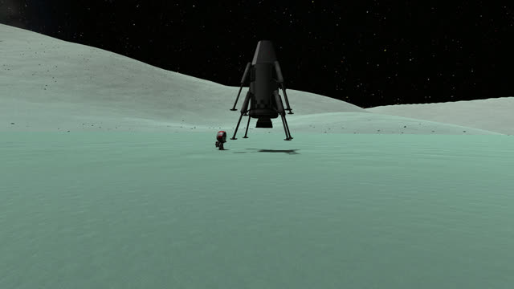

# Landed Shape Fix

**⚠️ Not finished yet.** This is a new fix, not a finished mod. The code and the conclusions on this page can still
change.

A fix for stock KSP 1.12: a few Harmony patches and a vessel module, in eight source files. It is a mod of its own,
built on top of [KSP Community Fixes](https://github.com/KSPModdingLibs/KSPCommunityFixes), the base most players
run. Here is what it fixes:

> **In KSP, a heavy base or rover standing on the ground jumps every time it is loaded.** It wakes up in the air and
> falls back, or wakes up with its wheels in the ground and is thrown out of it; the parts carried on docking ports
> bounce; a load swinging under a crane when the game was saved hangs still when it is loaded. The same happens every
> time time warp stops.

The game does not bring a landed vessel back the way it was saved: not at the height it was saved at, not in the
shape its weight bent it to, not with the speed its parts had, and with suspensions that start from nothing. This
mod brings it back as it was saved: see [The culprits](#the-culprits).

**How this was made.** The investigation and the code were written with Claude, Anthropic's AI
assistant. Everything here was reviewed and validated by a human — me. I am saying so up front, because
contributions made with an AI deserve a closer look than others, and because some people would rather
stop reading here. The stock code involved is named on this page; the mod itself is larger than a single patch, and
its vessel module is the part that deserves the closest look.

## Why it matters

A light vessel hardly shows any of this: its joints barely bend, and a few centimetres of fall do not shake it. A
heavy one, a base of hundreds of tonnes, a crane holding a tanker, a rover loaded with ore, shows all of it at once,
at every load and at every warp exit: the base drops, the modules on its docking ports swing, the crane's wheels hit
their stops.

**This mod needs two others to make sense.** It brings a vessel back exactly where and how it was saved. That is
only the right place if the ground under it is built where it was when the game was saved, and if its suspensions
hold it as they did:

- [Terrain Precision Fix](https://github.com/lhervier/KSP-Fix-TerrainPrecision): without it, the ground is built
  again at a slightly different height at every load, and a vessel put back exactly at its saved place ends up
  in the ground or above it.
- [Suspension Bounce Fix](https://github.com/lhervier/KSP-Fix-SuspensionBounce): without it, the wheels and landing
  legs throw the vessel again on their own, whatever pose it is given back.

Nothing checks that they are installed: this mod works without them, but it was made and tested with them.

## Two examples

**A large stock base on Kerbin.** This base, its modules carried on docking ports, was driven off the runway and
parked on the grass west of the space centre. It never left the ground since its launch, so the game still has it in
the `PRELAUNCH` situation. Without this mod, at every load and every time warp exit, KSP puts it back onto the ground
by its straight shape, which raises it, and the modules on their docking ports swing as the base drops back.
`KSP.log` says so at each of these moments:

```
[Base 1.25D v3]: ground contact! - error. Moving Vessel  up 0.179m
[Base 1.25D v3]: ground contact! - error. Moving Vessel  up 0.137m
```

With this mod, no such line is written, and the base stays where it was saved.


*KSP 1.12.5 and KSP Community Fixes, on Kerbin: the base loaded from its save, then time warped to mid-morning. The
two lines above were written by the load and by the end of the time warp.*

**A small lander on Minmus.** A Mk1 pod on a fuel tank and an engine, on four LT-1 landing legs, from the
[SuspensionBounceLegMinmus.sfs](https://github.com/lhervier/KSP-Fix-SuspensionBounce/blob/main/diag/SuspensionBounceLegMinmus.sfs)
save of Suspension Bounce Fix, loaded from the quickload menu (Alt+F9 by default). Without this mod, the lander leaves
the ground as soon as it is loaded, and lands back a few seconds later; saved again once at rest and loaded, it jumps
again, at every load. With this mod, the first load of that save still jumps, since the save holds no shape yet; saved
again with the mod and loaded, the lander stands still, and the mod writes:

```
[KSPFixLandedShape] SuspensionBounce Lander: shape put back on 8 of 8 saved part(s), largest move 0.0 mm on landingLeg1 (…); 8 wheel suspension(s) waiting for their wheel
[KSPFixLandedShape] SuspensionBounce Lander: let go after 2 physics step(s) held, 4 of 4 wheel(s) on the ground
```

No part is moved here: what keeps the lander on the ground is its leg suspensions given back their state, its
weight given back at once, and the hold until its legs touch the ground.



*KSP 1.12.5 and KSP Community Fixes, without this mod, on Minmus: SuspensionBounceLegMinmus.sfs loaded from the
quickload menu, the game paused about 1.4 s after the load.*

## The culprits

Four stock behaviours, each harmless alone on a light vessel, add up on a heavy one.

**A landed vessel is raised to the height the terrain is computed at.** At every load, `Vessel.getCorrectedLandedAltitude`
raises the vessel's root up to the height the terrain should have at its latitude and longitude, and never lowers
it. The ground the vessel actually rests on is the terrain's collider, made of flat triangles between points at that
height: on a summit, a ridge or the edge of a flattened area, those triangles pass below the computed height. A
vessel resting there is saved below that height, loaded above its own position, and falls the whole gap.

**A vessel that never left the ground since its launch is put back onto the ground by its straight shape.** Such a
vessel stays in the `PRELAUNCH` situation through saves and loads, like a base driven off the runway and parked.
`Vessel.GoOffRails` lets a landed vessel stay where it is when it leaves the rails, but not this one:

```csharp
// Vessel.GoOffRails (KSP 1.12)
if (PQSminLevel != 0 && PQSmaxLevel != 0 && situation != Situations.PRELAUNCH)
{
    skipGroundPositioning = PQSminLevel == mainBody.pqsController.minLevel && PQSmaxLevel == mainBody.pqsController.maxLevel;
}
```

So at every load and every warp exit, `Vessel.CheckGroundCollision` puts it back onto the ground by the lowest point
of its parts, measured while the vessel is still packed, in the shape it was built with. A vessel resting on its own
parts, bent under its weight, is raised by the difference, and falls it. `KSP.log` says so, with a line such as
`[Base]: ground contact! - error. Moving Vessel up 0.247m` at each of these moments.

**A vessel is saved in the shape it was built with, not the shape its weight gave it.** The game saves each part at
its construction pose (`Part.orgPos`, `Part.orgRot`), and puts it back there on every move while the vessel is
packed. A heavy vessel is therefore loaded straight: when physics starts, its joints bend again under the weight,
and the parts that were pressed into the ground (wheels at the end of their travel, tanks resting on the ground) are
pushed out of it. Light parts between heavy ones, such as docking ports carrying modules, bend the most.

**A vessel starts again at rest, weightless, and on suspensions of nothing.** Every part starts with no velocity,
so a load swinging under a crane hangs still. `VesselPrecalculate.StartEasing` then brings the vessel's weight back
from nothing over 16 physics steps (the *physics easing*, `GameSettings.PHYSICS_EASE`). And a wheel suspension saves
its settings, not the spring and damper they gave: `ModuleWheelSuspension` works them out again only once its wheel
touches the ground, a step or more after the unpack, so the vessel first stands on springs of almost nothing.

## The fixes

Two switches, in [Settings](#settings), both on by default.

- **`fixLandedLoad`: loaded where it was saved.**
  - A prefix of `Vessel.getCorrectedLandedAltitude` returns the saved altitude for every landed vessel, not splashed,
    around a body with a terrain.
  - A prefix of `Vessel.GoOffRails` keeps the guard the stock raise gave against a terrain changed since the save (a
    planet pack updated, for instance), measured against the ground itself: when the vessel leaves the rails, the
    ground is built under it, and if its root is then below that ground, the vessel is put back onto it as stock does
    when the terrain detail has changed. Where no terrain collider is found under it, it gets the stock raise.
    Vessels holding a ground part (a ground anchor, deployed science), riveted to the ground with their origin at or
    below it, skip that guard.
  - The same prefix lets a `PRELAUNCH` vessel that is not being launched skip the ground positioning as a `LANDED`
    one does, and goes through the same guard. A vessel being launched keeps the stock ground positioning.
- **`keepLandedShape`: brought back in its shape and motion.** A vessel module saves, for each part of a landed
  vessel, its pose relative to the root when it is not its construction pose, its velocity, the pose of the moving
  part of a robotic part, and the state of a wheel suspension (spring, damper, rest compression, whether it touched
  the ground). It takes them when the game is saved and when the vessel goes on rails (time warp, leaving the physics
  range).
  - When the vessel leaves the rails (`GameEvents.onVesselGoOffRails`), each part is put back in its saved pose,
    before the first physics step. The attach joints were created on the construction shape, so they get back the
    strain they had.
  - A prefix of `VesselPrecalculate.StartEasing` skips the physics easing of a vessel whose shape was just put back:
    it starts with its full weight, which its joints are bent for.
  - A postfix of `ModuleWheelBase.wheelSetup` gives each suspension back its state as soon as the game builds the
    wheel.
  - The vessel is held still until the wheels that touched the ground when it was saved touch it again (25 physics
    steps at most), then let go with the velocities its parts had.

  The velocities saved are those of the motion the game shows, measured from the poses of the last physics steps,
  not `Rigidbody.velocity`: on a light part held in a stiff chain of heavy ones, a docking port for instance, the
  physics engine reports a velocity of its own while the part does not move.

The shape is saved in the vessel, in a `LandedShapeModule` node; removing the mod drops it, and the vessel loads as
it does without the mod. If a stock method is missing, its patch is not applied, with an error in `KSP.log`.

**Why not raise the vessel by the lowest point of its bent shape.** The stock raise and ground positioning guard
against a ground that moved since the save. With the ground built where it was (Terrain Precision Fix), the saved
position is right: checking it against the ground found under the root keeps the guard, without moving a vessel
that is where it should be.

**Why give the velocities back.** A load swinging when the game was saved, or when time warp started, swings on
from where it was. Stopping it dead would be a jolt of its own.

## Limits

- **A structure that was swinging when time warp started keeps swinging after it.** Stock time warp brings it back
  straight and still; this mod brings it back as it was.
- **A pair of docking ports between heavy parts can still jump once at load.** The joint between two docked ports
  is created again at every load, and the physics engine solves the joints of a vessel in the order they were
  created. With that order changed, a light part in a stiff chain settles at a slightly different rest. The save
  cannot keep that order.
- **Only landed vessels.** A vessel in flight or in orbit gets nothing from this mod.

## Work in progress

What a player would see if this mod broke something, or what it should fix but was not checked yet, and how to try
it by hand, with the mod and without:

- **A ground anchor or deployed science** near a vessel: it should stay where it was saved, with the mod as without.
- **A vessel on a summit of the Mun**, saved and loaded five times: without the mod, it should drop at each load;
  with it, it should not move.
- **A vessel on a building of the space centre** or another static: it should load where it was saved.
- **A vessel whose parts changed** in EVA construction just before saving: the new parts should load in place.
- **A robotic part moving when the game is saved**: it should go on moving to its target.
- **Another planet pack, or another terrain mod**: Kopernicus, Real Solar System, BurstPQS. A vessel should load
  where it was saved, and be put back onto the ground if the terrain changed under it.
- **Without Terrain Precision Fix**: a vessel should load no worse than without this mod.

## Install

Copy the `GameData\KSPFixLandedShape` folder into the `GameData` folder of KSP. It needs
[Harmony](https://github.com/KSPModdingLibs/HarmonyKSP), as KSP Community Fixes does. Install
[Terrain Precision Fix](https://github.com/lhervier/KSP-Fix-TerrainPrecision) and
[Suspension Bounce Fix](https://github.com/lhervier/KSP-Fix-SuspensionBounce) with it: see
[Why it matters](#why-it-matters).

## Settings

`GameData\KSPFixLandedShape\PluginData\settings.cfg` is read once, when KSP starts:

```
// Loads a landed vessel at the altitude it was saved at: True or False.
fixLandedLoad = True

// Gives a landed vessel back its shape under load: True or False.
keepLandedShape = True

// How much the mod writes to KSP.log: Error, Warning, Info or Debug.
logLevel = Info
```

- With `fixLandedLoad = False`, a landed vessel is raised and put back onto the ground as without the mod.
- With `keepLandedShape = False`, a landed vessel loads straight, at rest, as without the mod; nothing is saved.
- At `Info`, the mod writes a line each time it puts a vessel's shape back (`shape put back on N of N saved
  part(s)`) and each time it lets it go (`let go after N physics step(s) held`). At `Debug`, it also writes one line
  per landed vessel loaded, with the height stock would have raised it by, and one per part put back.

## Build

Set `KSPDIR` to the folder of a KSP install with Harmony in its `GameData`, then run `build.bat`: it
compiles `GameData\KSPFixLandedShape\KSPFixLandedShape.dll`. Installing is up to you.

## License

[MIT](LICENSE).
