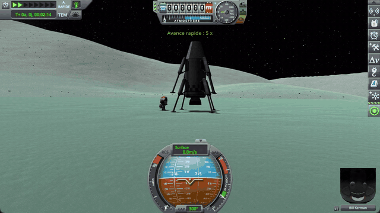

# Landed Shape Fix

**⚠️ Not finished yet.** This is a new fix, not a finished mod. The code and the conclusions on this page can still
change.

A fix for stock KSP 1.12: a few Harmony patches and a vessel module. It is a mod of its own,
built on top of [KSP Community Fixes](https://github.com/KSPModdingLibs/KSPCommunityFixes), the base most players
run. Here is what it fixes:

> **In KSP, a vessel standing on the ground can jump when physics starts on it: when the game is loaded, when time
> warp stops, or when you come within 200 m of it.** While it is on rails, the game places its parts in the shape the
> vessel was built with, not in the shape it was saved in, bent under its weight: some parts end up inside the
> ground, and are thrown out of it as soon as physics starts.



*Without this mod: a lander on Minmus as time warp stops ([Two examples](#two-examples)).*

The game does not bring a landed vessel back the way it was saved: not in the shape its weight bent it to, not at
the height it was saved at, not with the speed its parts had, and with suspensions that start from nothing. This
mod brings it back as it was saved: see [The culprits](#the-culprits).

**How this was made.** The investigation and the code were written with Claude, Anthropic's AI
assistant. Everything here was reviewed and validated by a human — me. I am saying so up front, because
contributions made with an AI deserve a closer look than others, and because some people would rather
stop reading here. The stock code involved is named and quoted in these pages; the mod itself is larger than a
single patch, and its vessel module is the part that deserves the closest look.

## Why it matters

Any vessel standing on the ground can show it, light or heavy, each in its own way, whenever physics starts on it:
at a load, at the end of a time warp, when you come back within 200 m.

- **On legs or wheels, even a light vessel.** When physics starts, its suspensions and its weight do not come back
  as they were when it was saved, and its legs throw it. The lander of [Two examples](#two-examples), a Mk1 pod on
  four landing legs, leaves the ground at each load and each time warp exit on Minmus, where it has little weight
  to hold it down.
- **A heavy vessel also loses its shape.** A base of hundreds of tonnes, a crane holding a tanker, a rover loaded
  with ore come back in the shape they were built with, not the one their weight bent them to, with parts inside the
  ground: they are pushed out of it, the modules on docking ports swing, the crane's wheels hit their stops.

**This mod needs others to make sense.** It brings a vessel back exactly where and how it was saved. That is only
the right place if the ground under it is built where it was when the game was saved, if the vessel starts with the
weight it was bent under, and if its suspensions hold it as they did:

- [Terrain Precision Fix](https://github.com/lhervier/KSP-Fix-TerrainPrecision): without it, the ground is built
  again at a slightly different height at every load, and a vessel put back exactly at its saved place ends up
  in the ground or above it. Stock hides part of it by raising every landed vessel at load, the raise this mod
  removes: see [The culprits](#the-culprits).
- [Physics Easing Fix](https://github.com/lhervier/KSP-Fix-PhysicsEasing): without it, the game takes the weight
  off the vessel when physics starts and brings it back over a few physics steps. A vessel put back in the shape its
  weight bent it to then relaxes while it is weightless, and bounces as its weight comes back. Physics Easing Fix
  gives it its full weight at once, and holds a vessel on wheels or landing legs still until they hold it; this mod
  gives the parts their velocities as it lets the vessel go.
- [Suspension Bounce Fix](https://github.com/lhervier/KSP-Fix-SuspensionBounce): without it, the wheels and landing
  legs throw the vessel again on their own, whatever pose it is given back.

Nothing checks that they are installed: this mod works without them, but it was made and tested with them.

## Two examples

### A large stock base on Kerbin

A base of stock parts, its modules carried on docking ports, on uneven ground west of the space centre. Held on rails,
its trusses stand up to half a metre inside the ground. Without this mod, every time physics starts on it, the whole
base is shaken and the modules swing for several seconds; with it, the base stays still.

**→ Full chapter: [A large stock base on Kerbin](docs/examples/a-large-stock-base-on-kerbin.md)**

### A small lander on Minmus

A Mk1 pod on four landing legs, from a published save. Without this mod, it leaves the ground at every load and every
time warp exit, although no part of it has to be moved: what it lacks is its suspensions and its weight as they were.

**→ Full chapter: [A small lander on Minmus](docs/examples/a-small-lander-on-minmus.md)**

## The culprits

Several stock behaviours add up; a heavy vessel shows them all.

### A vessel is saved in the shape it was built with

The game saves each part at its construction pose (`Part.orgPos`), not where its weight bent it to, and puts it back
there on every move while the vessel is on rails. A heavy vessel is loaded straight, and the parts that were pressed
into the ground are pushed out of it when physics starts.

**→ Full chapter: [A vessel is saved in the shape it was built with](docs/the-culprits/the-shape-it-was-built-with.md)**

### A landed vessel is raised to the height the terrain is computed at

At every load, `Vessel.getCorrectedLandedAltitude` raises a landed vessel up to the computed height of the terrain,
above the ground it actually rests on, and it falls the gap. It looks like a patch against vessels found inside a
ground that was not rebuilt at the same height, which is why this mod goes with Terrain Precision Fix.

**→ Full chapter: [A landed vessel is raised to the height the terrain is computed at](docs/the-culprits/the-raise-at-load.md)**

### A vessel waiting on the runway or the launch pad is put back onto the ground by its straight shape

A launched vessel that has not moved faster than 2.5 m/s yet, time warped until sunrise for instance, is put back
onto the ground by the lowest point of its straight shape at every time warp exit and every load, and falls.

**→ Full chapter: [A vessel waiting on the runway or the launch pad](docs/the-culprits/the-runway-and-the-launch-pad.md)**

### A vessel starts again at rest, weightless, and on suspensions of nothing

When physics starts, every part of a landed vessel has no velocity, its weight comes back from nothing over 16 physics
steps, and its suspensions are worked out again only once its wheels touch the ground. This mod gives back the
velocities and the suspensions; the weight given back at once, and the vessel held until its wheels hold it, are the
business of [Physics Easing Fix](https://github.com/lhervier/KSP-Fix-PhysicsEasing).

**→ Full chapter: [A vessel starts again at rest, weightless, and on suspensions of nothing](docs/the-culprits/at-rest-weightless-on-soft-suspensions.md)**

## The fixes

Its switches are in [Settings](#settings), all on by default.

- **`fixLandedLoad`: loaded where it was saved.** No raise at load, a vessel waiting on the runway or the launch pad
  left where it is; a guard puts a vessel back onto the ground only if its root is below the ground found under it.
- **`keepLandedShape`: brought back in its shape and motion.** A vessel module saves the pose and velocity of each
  part and the state of each wheel suspension, and gives them back when physics starts: the poses before the first
  physics step, each suspension state as the game builds its wheel, the velocities as Physics Easing Fix lets the
  vessel go. It drops them when the game itself puts the vessel back onto the ground.

Removing the mod drops what it saved, and vessels load as they do without it.

**→ Full chapter: [The fixes](docs/the-fixes.md)**

## Limits

- **A structure that was swinging when time warp started keeps swinging after it.** Stock time warp brings it back
  straight and still; this mod brings it back as it was.
- **A pair of docking ports between heavy parts can still jump once at load.** The joint between two docked ports
  is created again at every load, and the physics engine solves the joints of a vessel in the order they were
  created. With that order changed, a light part in a stiff chain settles at a slightly different rest. The save
  cannot keep that order.
- **Only landed vessels.** A vessel in flight or in orbit gets nothing from this mod.
- **A vessel whose weight changed while it was away moves when it loads.** A base with an ISRU, filling its tanks
  while another vessel is flown, comes back heavier than when its shape was saved: the shape it gets back is the one
  bent under its old weight, and it settles under the new one when physics starts: it swings when it loads, though
  none of its parts starts inside the ground. Tried with the base of [Two examples](#two-examples), its tanks emptied
  in the save, loaded, saved once at rest, then filled in the save and loaded: its modules swing for a few seconds,
  less than when the same save is loaded without this mod.
- **A terrain detail changed since the save: the vessel jumps once, as without the mod.** *Terrain detail*, in the
  graphics settings, can only change between two games, and the game then no longer trusts the saved position: it
  puts the vessel back onto the ground by the lowest point of its parts in the shape it was built with
  (`Vessel.CheckGroundCollision`). The saved shape no longer matches where the vessel stands, so the mod drops it,
  with its velocities and suspension states, and writes:

  ```
  [KSPFixLandedShape] SuspensionBounce Lander: put back onto the ground by the game as it leaves the rails, its saved shape is dropped
  [SuspensionBounce Lander]: ground contact! - error. Moving Vessel  down -0.160m
  ```

  The vessel then leaves the rails as it does without the mod. Saved again with the new terrain detail, it loads
  still. Seen with the lander of [Two examples](#two-examples), saved with the *High* terrain detail and loaded with
  *Default*.

## Work in progress

What a player would see if this mod broke something, or what it should fix but was not checked yet, and how to try
it by hand, with the mod and without:

- **The lander of [Two examples](#two-examples), with Physics Easing Fix**: load its save, save again once it is at
  rest, load that save, then time warp for a few seconds. With both mods, it should stand still at the load and at
  the end of the time warp; without this mod, it jumps each time.
- **A ground anchor or deployed science** near a vessel: it should stay where it was saved, with the mod as without.
- **A vessel on a summit of the Mun**, saved and loaded five times: without the mod, it should drop at each load;
  with it, it should not move.
- **A vessel waiting on the runway or the launch pad**, launch clamps included: launch it, time warp until sunrise,
  then save and load. With the mod, it should not jump at the end of the time warp nor at the load; without it, the
  game writes `Moving Vessel` each time.
- **A vessel on a building of the space centre** or another static: it should load where it was saved.
- **A vessel whose parts changed** in EVA construction just before saving: the new parts should load in place.
- **A robotic part moving when the game is saved**: it should go on moving to its target.
- **Another planet pack, or another terrain mod**: Kopernicus, Real Solar System, BurstPQS. A vessel should load
  where it was saved, and be put back onto the ground if the terrain changed under it.
- **Without Terrain Precision Fix**: a vessel should load no worse than without this mod.
- **Coming within 200 m of a landed vessel.** Leave a heavy landed vessel, or the lander of
  [Two examples](#two-examples), with another vessel until it is more than 350 m behind (it goes on rails), then come
  back: physics starts on it again when you come within 200 m. Without the mod, it should jump as it does when the
  game is loaded; with the mod, it should not move.

## Install

Copy the `GameData\KSPFixLandedShape` folder into the `GameData` folder of KSP. It needs
[Harmony](https://github.com/KSPModdingLibs/HarmonyKSP), as KSP Community Fixes does. Install
[Terrain Precision Fix](https://github.com/lhervier/KSP-Fix-TerrainPrecision),
[Physics Easing Fix](https://github.com/lhervier/KSP-Fix-PhysicsEasing) and
[Suspension Bounce Fix](https://github.com/lhervier/KSP-Fix-SuspensionBounce) with it: see
[Why it matters](#why-it-matters).

## Settings

`GameData\KSPFixLandedShape\PluginData\settings.cfg` is read once, when KSP starts:

```
// Loads a landed vessel at the altitude it was saved at: True or False.
fixLandedLoad = True

// Gives a landed vessel back its shape under load: True or False.
keepLandedShape = True

// How much the mod writes to KSP.log: Error, Warning, Info or Debug.
logLevel = Info
```

- With `fixLandedLoad = False`, a landed vessel is raised and put back onto the ground as without the mod.
- With `keepLandedShape = False`, a landed vessel loads straight, at rest, as without the mod; nothing is saved.
- At `Info`, the mod writes a line each time it puts a vessel's shape back (`shape put back on N of N saved
  part(s)`), each time it drops one (`its saved shape is dropped`), and each time its guard puts a vessel back onto
  the ground. The line `let go after N physics step(s) held` is written by Physics Easing Fix. At `Debug`, the mod
  also writes one line per landed vessel loaded, with the height stock would have raised it by, one per part put
  back, one per suspension given back its state, and one when the parts are given their velocities.

## Build

Set `KSPDIR` to the folder of a KSP install with Harmony in its `GameData`, then run `build.bat`: it
compiles `GameData\KSPFixLandedShape\KSPFixLandedShape.dll`. Installing is up to you.

## License

[MIT](LICENSE).
