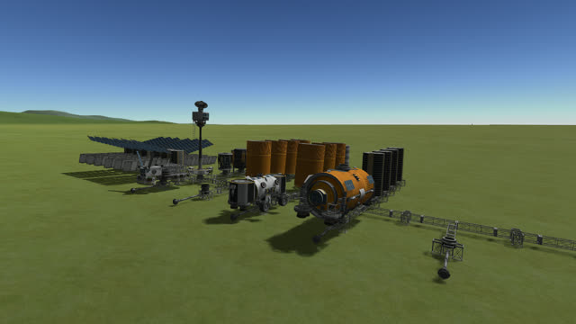
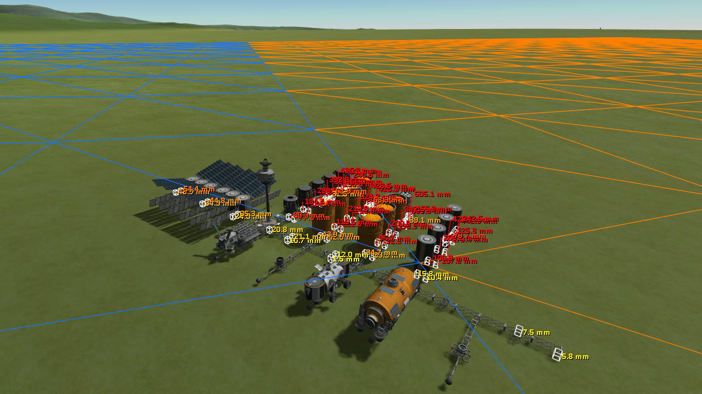

# A large stock base on Kerbin

Part of [Landed Shape Fix](../../README.md), [two examples](../../README.md#two-examples): a heavy vessel that loses
its shape.

This base, its modules carried on docking ports, stands on the grass west of the space centre, far enough from it for
the ground to be no longer flat: on the flattened ground around the space centre, the defect would hardly show.
Without this mod, every time physics starts on it, at a load or at the end of a time warp, the whole base is shaken,
and the modules on their docking ports swing for several seconds before they come to rest. With this mod, the base
stays still.

*KSP 1.12.5 and KSP Community Fixes, on Kerbin: the base loaded from its save, then time warped to mid-morning.*

## Held on rails

Held on rails by [KSP Diag - On Rails](https://github.com/lhervier/KSP-Diag-OnRails), the same base shows where its
parts are just before physics starts on it: in [the shape it was built
with](../the-culprits/the-shape-it-was-built-with.md), the trusses under its tanks and radiators stand inside the
ground, the deepest by 505 mm according to the Diag's window. When physics starts, the ground pushes them out.

*KSP 1.12.5, KSP Community Fixes and KSP Diag - On Rails, on Kerbin: Keep vessels on rails ticked at the space
centre, the base loaded from its save and time warped to mid-morning, still on rails; the Diag in its Through
everything mode, its window hidden.*
