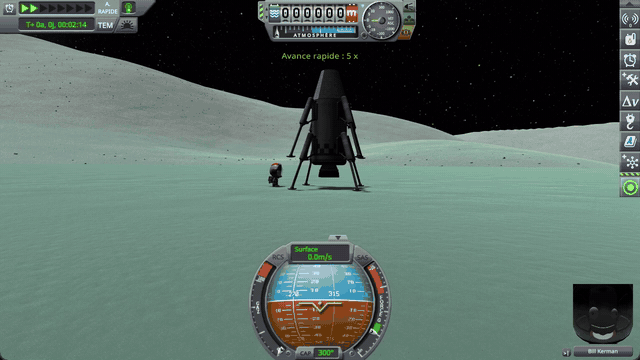

# A small lander on Minmus

Part of [Landed Shape Fix](../../README.md), [two examples](../../README.md#two-examples): a light vessel on legs.

A Mk1 pod on a fuel tank and an engine, on four LT-1 landing legs, from the
[SuspensionBounceLegMinmus.sfs](https://github.com/lhervier/KSP-Fix-SuspensionBounce/blob/main/diag/SuspensionBounceLegMinmus.sfs)
save of Suspension Bounce Fix, loaded from the quickload menu (Alt+F9 by default).

Without this mod, the lander leaves the ground as soon as it is loaded, and lands back a few seconds later; saved
again once at rest and loaded, it jumps again, at every load, and the same way every time time warp stops.



*KSP 1.12.5 and KSP Community Fixes, without this mod, on Minmus: the save loaded, saved again once the lander was at
rest and loaded again; once at rest, time warp at ×5 for about 3 s, then back to normal time. The recording starts
at the end of the time warp.*

With this mod, the first load of that save still jumps, since the save holds no shape yet; saved again with the mod
and loaded, the lander stands still, and the mod writes:

```
[KSPFixLandedShape] SuspensionBounce Lander: shape put back on 8 of 8 saved part(s), largest move 0.0 mm on landingLeg1 (…); 8 wheel suspension(s) waiting for their wheel
[KSPFixLandedShape] SuspensionBounce Lander: let go after 2 physics step(s) held, 4 of 4 wheel(s) on the ground
```

No part is moved here: what keeps the lander on the ground is its leg suspensions given back their state, its weight
given back at once, and the hold until its legs touch the ground (see
[the culprit](../the-culprits/at-rest-weightless-on-soft-suspensions.md)).
