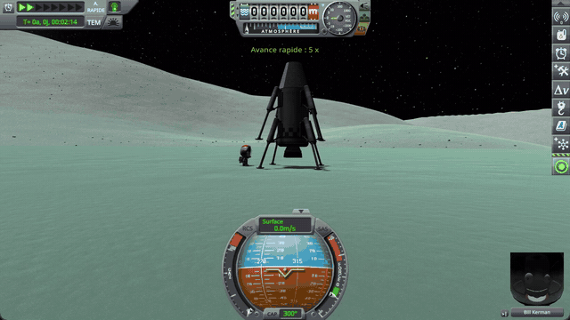

# A vessel starts again at rest, weightless, and on suspensions of nothing

Part of [Landed Shape Fix](../../README.md), [the culprits](../../README.md#the-culprits): what a vessel loses of its
motion, its weight and its suspensions when physics starts.

**At rest.** Every part of a landed vessel starts with no velocity, so a load swinging under a crane hangs still:

```csharp
// Part.ResumeVelocity (KSP 1.12): a landed vessel's parts start with no velocity
vel = Vector3.zero;
if (!vessel.LandedOrSplashed)
{
    // ... the orbital velocity, for a vessel in flight
}
rb.velocity = vel;
```

**Weightless.** `VesselPrecalculate.StartEasing` then brings the vessel's weight back from nothing over 16 physics
steps (the *physics easing*, `GameSettings.PHYSICS_EASE`, on by default). Meant for a vessel set down roughly, it
takes the weight off a vessel standing on its legs or bent under its load:

```csharp
// VesselPrecalculate.StartEasing (KSP 1.12)
vessel.gravityMultiplier = 0.0;
```

**On suspensions of nothing.** A wheel suspension saves its settings, not the spring and damper they gave.
`ModuleWheelSuspension` works them out again only once its part is unpacked and its wheel touches the ground, a step
or more after the unpack, so the vessel first stands on springs of almost nothing:

```csharp
// ModuleWheelSuspension.FixedUpdate (KSP 1.12): the spring and damper, private fields that are not saved, are worked
// out only once the part is unpacked and its wheel touches the ground
if (HighLogic.LoadedSceneIsFlight && baseSetup && !base.part.packed && wheel != null && wheel.IsGrounded)
{
    vesselMass = (float)base.vessel.totalMass;
    SuspensionSpringUpdate(vesselMass);
```

[A small lander on Minmus](../examples/a-small-lander-on-minmus.md) shows it: no part of it has to be moved, and it
still leaves the ground at every load and every time warp exit.



*KSP 1.12.5 and KSP Community Fixes, without this mod, on Minmus: the
[SuspensionBounceLegMinmus.sfs](https://github.com/lhervier/KSP-Fix-SuspensionBounce/blob/main/diag/SuspensionBounceLegMinmus.sfs)
save loaded, saved again once the lander was at rest and loaded again; once at rest, time warp at ×5 for about 3 s,
then back to normal time. The recording starts at the end of the time warp.*
