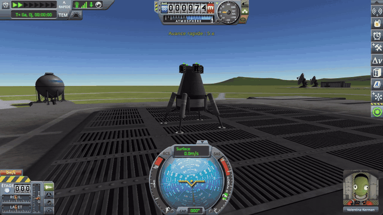

# A vessel waiting on the runway or the launch pad is put back onto the ground by its straight shape

Part of [Landed Shape Fix](../../README.md), [the culprits](../../README.md#the-culprits): a vessel that has not taken
off yet is moved at every time warp exit and every load.

A launched vessel stays in the `PRELAUNCH` situation, through time warps, saves and loads, until it moves faster than
2.5 m/s (`Vessel.updateSituation`): a vessel launched, then time warped until sunrise before it takes off, is one, as
is a vessel saved on the runway or the launch pad and loaded again. So is a vessel moved elsewhere before it ever went
that fast, with the cheat menu for instance.

`Vessel.GoOffRails` lets a landed vessel stay where it is when it leaves the rails, but not this one:

```csharp
// Vessel.GoOffRails (KSP 1.12)
if (PQSminLevel != 0 && PQSmaxLevel != 0 && situation != Situations.PRELAUNCH)
{
    skipGroundPositioning = PQSminLevel == mainBody.pqsController.minLevel && PQSmaxLevel == mainBody.pqsController.maxLevel;
}
```

So at every load and every time warp exit, `Vessel.CheckGroundCollision` puts it back onto the ground by the lowest
point of its parts, measured while the vessel is still packed, in
[the shape it was built with](the-shape-it-was-built-with.md): it is moved, up or down, by the difference. A vessel
resting on its own parts, bent under its weight, is raised, and falls back; a vessel on soft legs can be lowered
into them, and is thrown back up. `KSP.log` says so at each of these moments, with a line such as
`[Base]: ground contact! - error. Moving Vessel up 0.179m`.



*KSP 1.12.5 and KSP Community Fixes, without this mod, on the launch pad:
[LandedShape Lander.craft](../../diag/LandedShape%20Lander.craft), a Mk1 pod, a probe core and batteries on a fuel
tank, on four LT-1 landing legs with soft springs (0.15) and strong dampers (2), their automatic setting off,
launched onto the launch pad from the vehicle assembly building; once at rest, time warp at ×5 for about 3 s, then
back to normal time. `KSP.log`: `[LandedShape Lander]: ground contact! - error. Moving Vessel  down -0.126m`. The
recording starts at the end of the time warp.*
