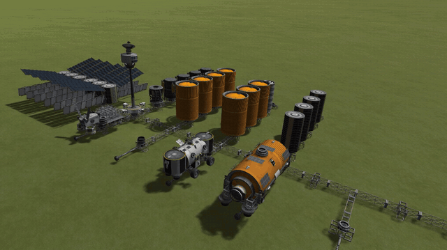

# A vessel is saved in the shape it was built with

Part of [Landed Shape Fix](../../README.md), [the culprits](../../README.md#the-culprits): the shape its weight gave a
vessel is lost at every save and every time warp.

The game saves each part at its construction pose (`Part.orgPos`, `Part.orgRot`), never where its load bent it to:

```csharp
// ProtoPartSnapshot(Part, ProtoVessel, bool) (KSP 1.12): what a save keeps of a part's place
position = partRef.orgPos;
rotation = partRef.orgRot;
```

While the vessel is packed (on rails), every move puts its parts back on that pose:

```csharp
// Vessel.SetPosition(Vector3d, bool) (KSP 1.12): a packed vessel moved, its parts put back on that pose
part.partTransform.position = position + quaternionD * part.orgPos;
```

A heavy vessel is therefore loaded straight. When physics starts, its joints bend again under the weight, and the
parts that were pressed into the ground (wheels at the end of their travel, tanks resting on the ground) are pushed
out of it. Light parts between heavy ones, such as docking ports carrying modules, bend the most. The same happens at
the end of a time warp, which packs the vessel, and when you come back within 200 m of a vessel left on rails.

The attach joints are created while the vessel is packed, on the construction shape: their rest is that shape. Put
back in its bent shape before the first physics step, a vessel gives its joints back the strain they had when it was
saved.

[A large stock base on Kerbin](../examples/a-large-stock-base-on-kerbin.md) shows it: held on rails, its trusses stand
up to half a metre inside the ground.



*KSP 1.12.5 and KSP Community Fixes, without this mod, on Kerbin: the base loaded from its save and time warped to
mid-morning; once at rest, time warp at ×5 for about 3 s, then back to normal time. The recording starts at the end
of the time warp.*
